# 🏥 Hospital Management System

[](https://github.com/23f2004695/Hospital-Management-System/actions/workflows/tests.yml)


A web app for small hospitals and clinics to manage **doctors, patients, appointments and treatments**. It has three roles: admins run the hospital, doctors set their hours and record treatments, and patients book appointments and track their medical history.

Built with Flask, Jinja templates and SQLite, so it runs anywhere with no setup beyond `pip install`.

> This was my App Dev project for the IIT Madras BS degree. The follow-up single-page version (Vue + REST API + Redis + Celery) is [HMSV2](https://github.com/23f2004695/HMSV2).

<p align="center">
  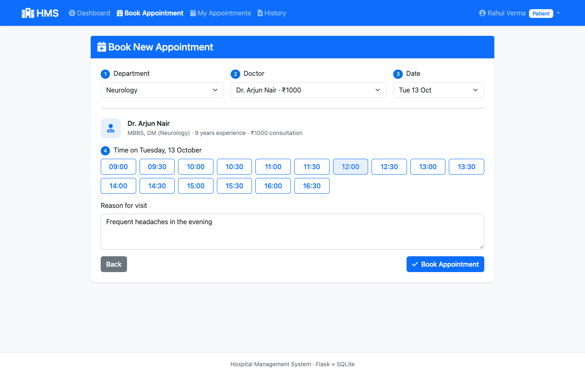
</p>

## Features

**Admin**
- Dashboard with doctor, patient and appointment counts and a status breakdown
- Add, edit, delete doctors, or mark them unavailable without losing their records
- Search patients by name, ID, email or phone, open their full history, and block or unblock them
- See and filter every appointment in the hospital, and cancel bookings

**Doctor**
- Today's schedule, the coming week and the number of patients seen
- Set working hours for each of the next 7 days
- Complete a visit by recording diagnosis, prescription, notes and follow-up date
- Open the full history of any patient who has booked with them

**Patient**
- Register, log in and keep their profile (blood group, medical history, emergency contact) up to date
- Book in four steps: department → doctor → day → free 30-minute slot
- Cancel upcoming appointments and view every past diagnosis and prescription

## Screenshots

| Admin dashboard | Patient record |
|---|---|
| 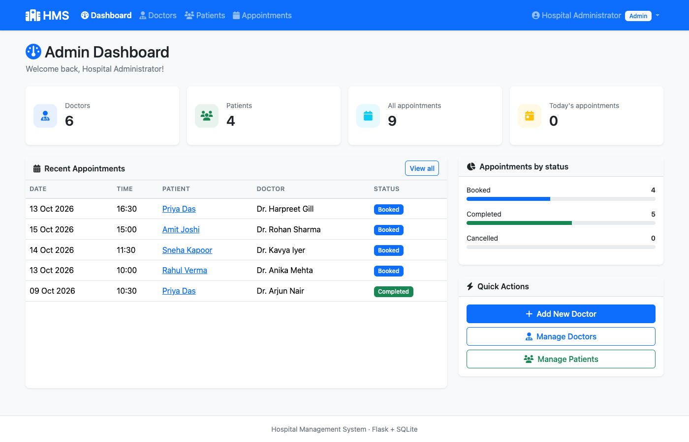 | 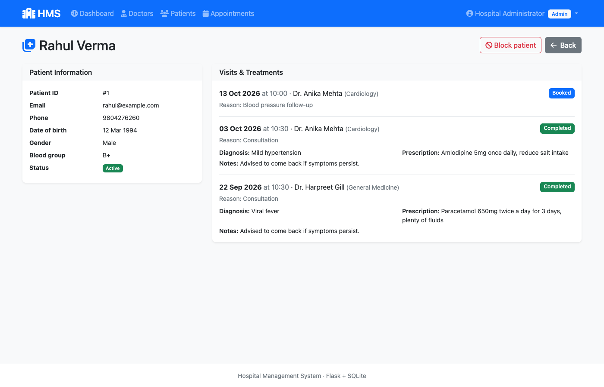 |
| **Patient dashboard** | **Treatment history** |
| 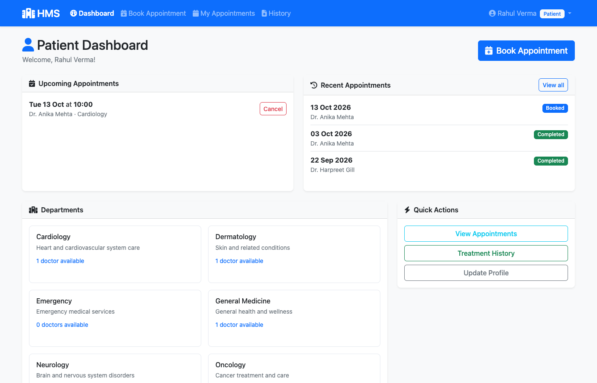 | 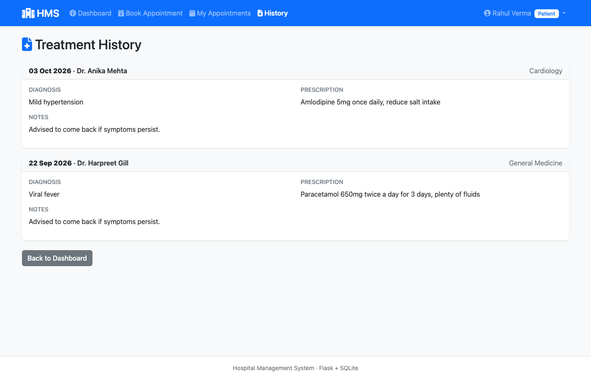 |
| **Doctor dashboard** | **Recording a treatment** |
| 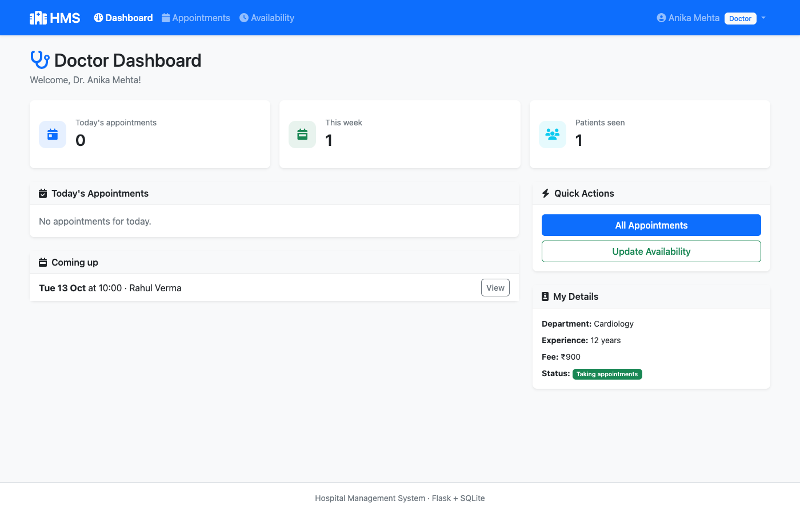 | 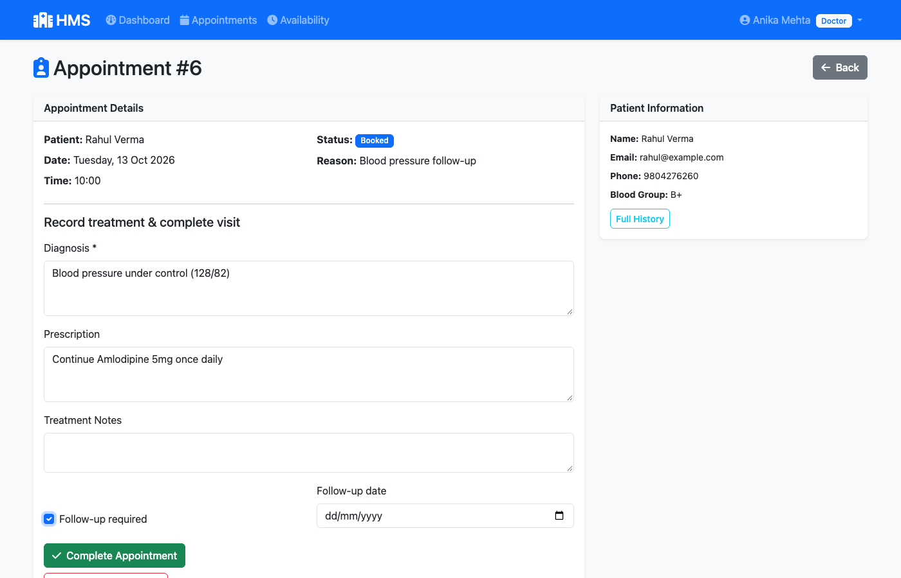 |
| **Doctor availability** | **Managing patients** |
| 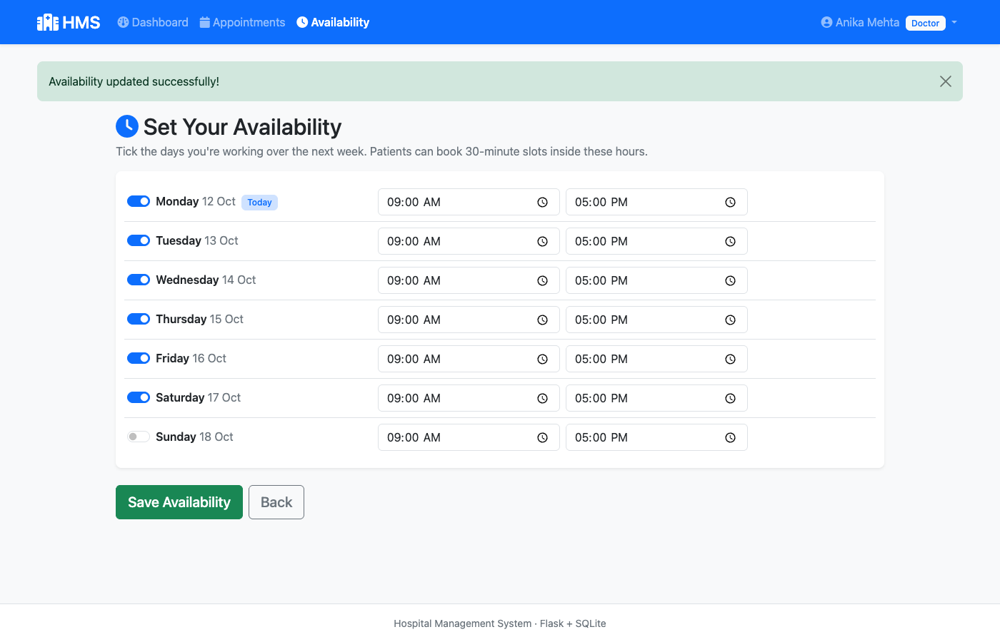 | 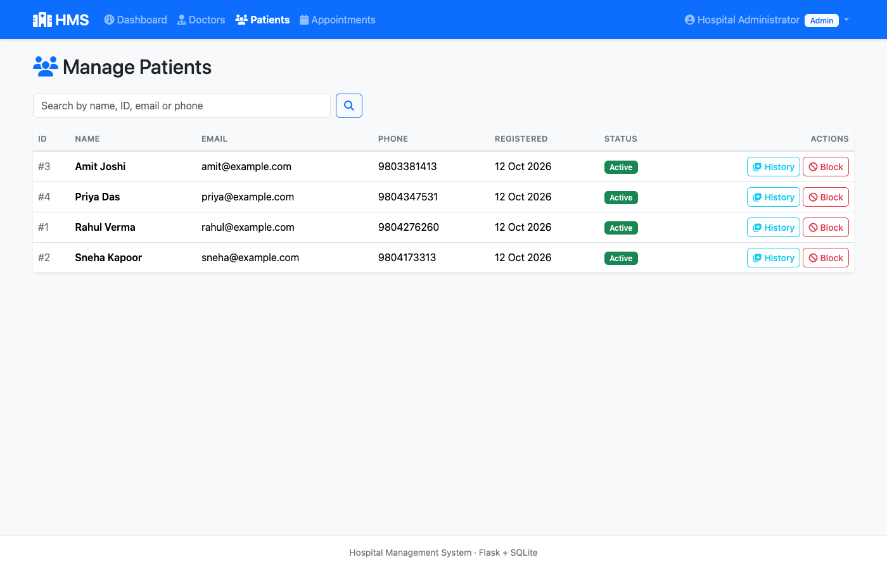 |

<details>
<summary>Landing page and mobile view</summary>

<p>
  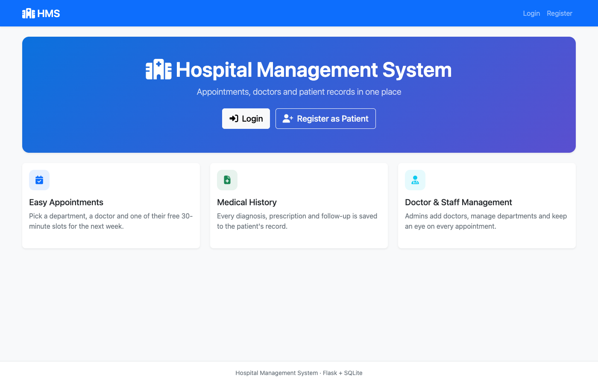
  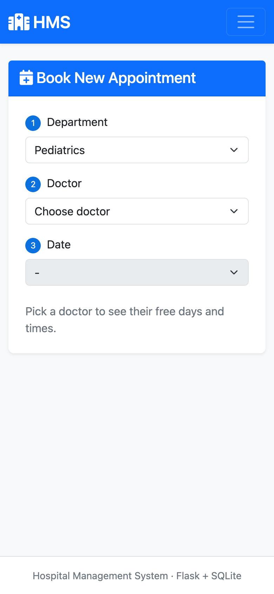
</p>
</details>

## How booking works

1. A doctor marks which of the next 7 days they work and their hours (say 09:00–17:00).
2. Those hours are split into 30-minute slots. Slots that are already booked, or already in the past today, are hidden.
3. The patient picks a department, a doctor, a day and a slot.
4. Before saving, the server checks again that the slot is still free and that the patient isn't already booked somewhere else at that time.

## Tech stack

| Layer | Tools |
|---|---|
| Backend | Flask 3, Flask-Login, Flask-WTF (CSRF protection) |
| Database | SQLite via Flask-SQLAlchemy / SQLAlchemy 2 |
| Frontend | Jinja2 templates, Bootstrap 5, Font Awesome |
| Tests | pytest (39 tests), run on every push with GitHub Actions |

## Getting started

You need Python 3.11 or newer.

```bash
git clone https://github.com/23f2004695/Hospital-Management-System.git
cd Hospital-Management-System
python -m venv venv
source venv/bin/activate          # Windows: venv\Scripts\activate
pip install -r requirements.txt

python seed_demo.py               # optional: demo doctors, patients and appointments
python main.py                    # http://127.0.0.1:5001
```

The database, the default departments and the admin account are created automatically on first run.

| Role | Username | Password |
|---|---|---|
| Admin | `admin` | `admin123` |
| Doctors (demo data) | `dr.mehta`, `dr.sharma`, `dr.iyer`, `dr.khan`, `dr.gill`, `dr.nair` | `demo123` |
| Patients (demo data) | `rahul`, `sneha`, `amit`, `priya` | `demo123` |

Pick the matching role on the login screen.

### Configuration

Everything works out of the box. To change the admin password, the database location or the port, see [`.env.example`](.env.example) and set those variables before starting. The session secret key is generated randomly on first run and kept in `instance/secret_key`. To turn on Flask's debugger while developing, set `FLASK_DEBUG=1`.

## Running the tests

```bash
pip install -r requirements-dev.txt
pytest
```

The tests cover logins and role checks, the booking rules (slots, double booking, past times, unavailable doctors), visit completion, availability, admin management and CSRF protection.

## Security

- Passwords are hashed with Werkzeug
- Every form and every action that changes data (cancel, delete, block, logout) is a POST protected by a CSRF token
- Each page checks the user's role, and doctors can only see their own appointments and patients
- The session key is random and never stored in the code
- The debugger is off by default and the server only listens on localhost

## Project structure

```
├── main.py                 # entry point
├── seed_demo.py            # demo data
├── app/
│   ├── __init__.py         # app factory, login, CSRF, error pages, first-run setup
│   ├── models.py           # Admin, Doctor, Patient, Department, Appointment, Treatment, availability
│   ├── utils.py            # role checks and form validation
│   ├── routes/             # auth, admin, doctor and patient blueprints
│   ├── templates/          # Jinja pages (one folder per role)
│   └── static/css/
├── tests/                  # pytest suite
└── docs/
    ├── project-report.pdf
    └── screenshots/
```

## Project report

The original project report is in [`docs/project-report.pdf`](docs/project-report.pdf).
